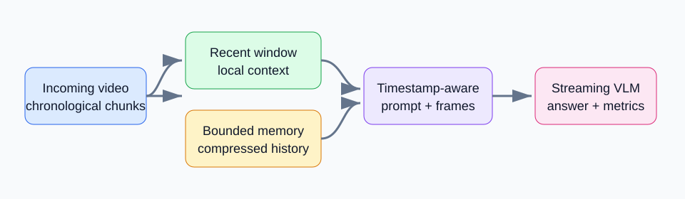

# Streaming Video Understanding with Lightweight Temporal Memory

Latest: [visual and option sensitivity diagnostic](experiments/2026-10-26/visual-sensitivity/README.md),
20 QA / 80 generations. Original/blank/reverse each score 20%; option-cycle 40%,
but only 1/20 answer contents persist after permutation. These are diagnostics,
not accuracy gains; exact frozen local input is required for replay.

Previous follow-up: [frame-change memory diagnostic](experiments/2026-10-26/change-memory/README.md),
20 QA / 60 generations. Change-4+4 scores 20% versus 15% for controls, but a
posthoc constant-C rule matches its correctness vector; no stable gain established.

Latest diagnostic (2026-10-26): fixed8-frame temporal coverage on20countingQA,
60generations; Recent-8 /60s bins /prefix bins all3/20(15%). Wider temporal span
alone did not improve this pilot. See [protocol, audit and limitations](experiments/2026-10-26/context-coverage/README.md).

一个面向 streaming video understanding 的小型、可复现研究工程。项目比较固定视觉预算下的 recent-window、uniform-history，以及“recent local context + compressed global memory”策略，并显式检查 query timestamp 之后的帧不能进入推理。

## Motivation

离线长视频模型可以访问完整视频，但持续到来的视频系统必须在有限显存和固定 memory budget 下工作。本项目把问题约束为：模型只看到当前 timestamp 之前的内容，并在不重复编码完整历史的前提下回答视频问题。

## Research Question

Can a lightweight temporal memory improve streaming video understanding without repeatedly encoding the entire video history?

项目与 TAMS 的关系是研究动机上的连续性：TAMS 关注 offline long-video temporal grounding 中的 timestamp-aware compressed representation；本项目独立实现 online / streaming protocol，研究 bounded historical memory 与 local recent context 的组合。

## Streaming Protocol

- Primary benchmark timestamp 使用 StreamingBench 的 `time_stamp`。
- 默认只暴露 query timestamp 前 60 秒的内容。
- frame buffer、memory、sampler、prompt 和 resume key 都遵守同一个 causal boundary。
- `timestamp <= query_time + 1e-6` 是唯一允许的边界；未来帧会在 backend 调用前抛出错误。
- 每次只进行一个样本、一个请求的推理，优先适配 6GB RTX 3060 Laptop GPU。

## Method

每个 query 维护两类上下文：最近帧提供局部高分辨率 temporal context，历史帧经过固定容量压缩形成 global memory。Timestamp-aware 版本在 prompt 中同时提供绝对 timestamp 和相对 query 时间，frame selection 本身保持可控一致，便于解释 ablation。

Architecture placeholder:



## Baselines

固定总 visual budget 的主实验包含：

- `recent-8`
- `uniform-8`
- `recent-4+uniform-memory-4`
- `recent-4+timestamp-aware-memory-4`

Sensitivity 实验在 6GB RTX 3060 上只比较安全可运行的总预算 B=4 和 B=8：
`recent-4` vs `recent-2+timestamp-aware-memory-2`，以及
`recent-8` vs `recent-4+timestamp-aware-memory-4`。

## Installation

Python 3.12+ recommended。先根据本机 CUDA / PyTorch 版本安装匹配的 PyTorch wheel，再安装其余依赖：

```bash
python -m venv .venv
python -m pip install --upgrade pip
# 按本机 CUDA 选择 torch / torchvision wheel
python -m pip install -r requirements.txt
```

MVP 默认 backend 是 `HuggingFaceTB/SmolVLM2-500M-Video-Instruct`；模型只在显式运行 `--backend smolvlm` 时下载。不要把模型权重、Hugging Face cache 或视频数据提交到 Git。

## Dataset

主数据集为公开的 [StreamingBench](https://streamingbench.github.io/)，其官方代码和数据入口见 [THUNLP-MT/StreamingBench](https://github.com/THUNLP-MT/StreamingBench) 与 [Hugging Face dataset repository](https://huggingface.co/datasets/mjuicem/StreamingBench)。完整仓库较大，本项目只下载 `real-time-1-50` bounded archive；脚本会显示约 9.08GB archive target，并要求至少 25GB 可用空间与显式确认。

```bash
python scripts/download_data.py \
  --subset real-time-1-50 \
  --destination data/streamingbench \
  --confirm-large-download
```

The video archive and QA annotations are distributed separately. After the
video archive is extracted, download the 250 timestamped QA rows for the
bounded 1-50 subset:

```bash
python scripts/download_annotations.py \
  --subset real-time-1-50 \
  --destination data/streamingbench/real-time-1-50/annotations.jsonl
```

数据集卡片没有在本项目中重新声明一个额外 license；使用者必须遵守上游数据集、视频来源和 Hugging Face 条款。本仓库不重新分发视频或模型权重。

## Evaluation

配置位于 `configs/main.yaml` 和 `configs/sensitivity.yaml`。评测输出 JSONL，使用 `(sample_id, config_id)` resume；每条 record 保存 selected frame IDs、timestamps、prediction、correctness、decode/model latency、input frames 和 peak GPU memory。

先运行无需下载数据和模型的 smoke evaluator：

```bash
python scripts/run_eval.py --config configs/main.yaml \
  --backend mock --limit 3 --output results/mock-smoke.jsonl --resume
python scripts/benchmark_runtime.py \
  --input results/mock-smoke.jsonl \
  --output results/mock-smoke-summary.json
```

真实数据运行时增加 `--data-root data/streamingbench/real-time-1-50`，使用 `--annotations annotations.jsonl` 和 `--backend smolvlm`。如果目录中存在多个 annotation 文件，请用 `--annotations` 指定 CSV / JSON / JSONL / Parquet 文件。所有策略都通过统一 evaluator 运行，避免不同方法拥有不同的数据可见范围。

运行 checked-in 主矩阵时使用 `--all-policies`，它会读取 `configs/main.yaml` 中的四个 policy IDs；不加该选项时默认只跑 `recent-B`，便于 smoke 和单策略调试。

## Stage 1 Semantic Retrieval (experimental)

Stage 1 adds two policy IDs: `recent-4+semantic-memory-4` and
`recent-4+semantic-diverse-memory-4`. Both use a fixed 4+4 visual budget:
four recent frames plus four semantic-memory frames. Semantic retrieval is an
experiment; no accuracy gain has been proven yet.

The scorer contract is Q-only: CLIP receives the sample question as its text
query and scores visible history frames. It receives neither ground-truth
answers nor option text. Stage 1 uses no GT/options in semantic retrieval;
ground truth is only used by the evaluator for scoring.

The extracted data used below is `data/streamingbench/real-time-1-50`; no
larger extracted subset is claimed as available. Selected timestamps must be
at or before the query timestamp.

### Semantic cache

The configured feature cache is `.cache/semantic_features`. The observed
Hugging Face CLIP cache is
`E:\NewApplication\CodeToRun\forCV\streaming-video-understanding\hf_cache\hub\models--openai--clip-vit-base-patch32`.
The first semantic run downloads the model/processor and creates cache
artifacts; later runs reuse them. The measured post-download footprint was
approximately 1157.8 MiB (about 1.16 GB), including cache artifacts. This is
a measured cache footprint, not a theoretical model-size claim; keep caches
out of Git.

### Semantic validation commands

Full test suite:

```bash
python -m pytest -q
```

One-sample mock semantic smoke:

```bash
python scripts/run_eval.py \
  --config configs/semantic-validation-1fps.yaml \
  --data-root data/streamingbench/real-time-1-50 \
  --annotations annotations.jsonl \
  --backend mock \
  --policy recent-4+semantic-diverse-memory-4 \
  --limit 1 \
  --output results/semantic-mock-smoke.jsonl \
  --profile-output results/semantic-mock-smoke-profile.jsonl \
  --overwrite
```

One-sample real SmolVLM semantic-diverse smoke:

```bash
python scripts/run_eval.py \
  --config configs/semantic-validation-1fps.yaml \
  --data-root data/streamingbench/real-time-1-50 \
  --annotations annotations.jsonl \
  --backend smolvlm \
  --policy recent-4+semantic-diverse-memory-4 \
  --limit 1 \
  --output results/semantic-smolvlm-smoke.jsonl \
  --profile-output results/semantic-smolvlm-smoke-profile.jsonl \
  --overwrite
```

Full available-subset validation:

```bash
python scripts/run_eval.py \
  --config configs/semantic-validation-1fps.yaml \
  --data-root data/streamingbench/real-time-1-50 \
  --annotations annotations.jsonl \
  --backend smolvlm \
  --all-policies \
  --output results/semantic-validation-real-time-1-50.jsonl \
  --profile-output results/semantic-validation-real-time-1-50-profile.jsonl \
  --resume
```

The full controlled semantic accuracy result for the available 250-QA
`real-time-1-50` subset is reported below. The 100-video/500-QA expansion
remains pending because current annotations cover only 1-50.

### Semantic validation results

The completed run contains 5 policies × 250 QA = 1,250 records. It used one
process with a shared feature cache. All policies had `runtime_failed=0`,
`causal_violations=0`, `budget_violations=0`, average input frames of `7.944`,
and peak GPU memory of `3834.389648 MB`.

| Policy | Correct / 250 | Accuracy | P50 latency (s) | P95 latency (s) | Retrieval mean (ms) |
|---|---:|---:|---:|---:|---:|
| recent-8 | 163 | 65.2% | 22.381 | 59.668 | 0 |
| uniform-8 | 157 | 62.8% | 21.910 | 59.005 | 0 |
| recent-4+uniform-memory-4 | 160 | 64.0% | 21.862 | 58.799 | 0 |
| recent-4+semantic-memory-4 | 159 | 63.6% | 21.922 | 59.710 | 774.724 |
| recent-4+semantic-diverse-memory-4 | 157 | 62.8% | 21.929 | 58.401 | 47.460 |

`semantic_selection_trace` was non-empty for 248/250 records for each semantic
policy; the two missing traces had no historical frames at the query point.
All selected timestamps were causal. Recent-8 remains best at 65.2%:
semantic-memory is -1.6 percentage points and semantic-diverse is -2.4 points
relative to Recent-8. This result does not show an accuracy improvement.

Retrieval latency is cache- and execution-order-sensitive, not an isolated
cold-start comparison: semantic-memory ran first and includes cache
population, while semantic-diverse mostly read the warm shared cache. Summary
files are available as ignored local artifacts under `results/`.

## Stage 1B Option-Aware Semantic Retrieval

Stage 1B keeps the same causal protocol and fixed visual budget, but scores
each historical frame against four ordered hypotheses:
`Question: ... Candidate answer: ...`. The scorer receives the question and
the four candidate options, never the ground-truth answer. For each frame, the
evaluator records all four CLIP scores, the best option index, and the top-1 /
top-2 margin. The two added policy IDs are
`recent-4+option-semantic-memory-4` and
`recent-4+option-semantic-diverse-memory-4`.

The validation command was:

```bash
python scripts/run_eval.py \
  --config configs/option-semantic-validation-1fps.yaml \
  --data-root data/streamingbench/real-time-1-50 \
  --annotations annotations.jsonl \
  --backend smolvlm \
  --all-policies \
  --output results/option-semantic-validation-real-time-1-50.jsonl \
  --profile-output results/option-semantic-validation-real-time-1-50-profile.jsonl \
  --cache-decoded-frames \
  --resume
```

The completed run contains **500 records = 250 QA × 2 option-aware
policies**, still from the available 50-video / 250-QA `real-time-1-50`
subset. It is not the pending 100-video / 500-QA expansion.

| Policy | Correct / 250 | Accuracy | P50 latency (s) | P95 latency (s) | Retrieval mean (ms) | Peak GPU (MB) |
|---|---:|---:|---:|---:|---:|---:|
| recent-4+option-semantic-memory-4 | 164 | 65.6% | 22.577 | 68.136 | 78.465 | 3834.4 |
| recent-4+option-semantic-diverse-memory-4 | 164 | 65.6% | 22.679 | 69.330 | 55.419 | 3834.4 |

Both policies averaged `7.944` input frames and passed the full audit:
`runtime_failed=0`, `causal_violations=0`, `budget_violations=0`, and
`option_schema_violations=0`. Against the paired Recent-8 records, the
option-semantic policy helped/hurt/unchanged on `10/9/231` QA items and the
option-semantic-diverse policy on `12/11/227` items. Both are `+0.4` percentage
points over Recent-8 on this subset; this is a measured local result, not a
claim of general improvement. Against Q-only semantic memory, the respective
paired counts were `8/3/239` and `9/4/237`, or `+2.0` percentage points.

Retrieval latency is sensitive to shared feature-cache state and policy
execution order. The first policy includes more cache work; the second mostly
reads warm cached image features. Therefore the retrieval timings should be
reported with this caveat rather than treated as a clean cold-start ranking.

### Task 8 smoke evidence

- Full pytest after Task 7: **249 passed**.
- Mock semantic-diverse smoke: `processed=1 skipped=0`; selected/input frames
  `5` because `query_time=4.0` exposed only five 1fps frames; selected
  timestamps `0..4 <= query_time`; semantic trace count `1`;
  `retrieval_latency_ms=990.394 ms`. This is mock pipeline evidence, not
  accuracy evidence.
- Real SmolVLM semantic-diverse smoke on the same data:
  `processed=1 skipped=0`, no OOM, `input_frames=5`, selected timestamps
  `0..4`, semantic trace count `1`, `retrieval_ms=493.4114`,
  `model_latency_ms=3433.9946`, record `latency_ms=4201.0253`, and
  `peak_gpu_memory_mb=2877.4521`; profile `total_ms=4702.2538`.
  Record latency and profile total are different accounting layers.
- These one-sample checks do not establish semantic accuracy or an accuracy
  improvement; the full controlled semantic accuracy is reported above.

## Selective-memory follow-up

The question-only `adaptive-semantic-v1` policy allocates a fixed eight-frame
budget among recent context and semantic history, with explicit route traces.
Implementation, video-cluster paired diagnosis, evidence annotation instructions,
and experiment status: [Selective memory stage 1](docs/SELECTIVE_MEMORY_STAGE1.md).
On videos 51–100 (250 QA), adaptive routing scored 36.8% versus Recent-8's 38.0%
(paired delta -1.2 pp, video-cluster CI95 [-4.0, +1.6] pp). No overall gain was
established. Public summaries: [completed experiments](experiments/2026-10-25/README.md).
The existing candidate horizon is 60 seconds; persistent incremental ingestion
remains future work.

## Results

Counting-case follow-up: on 11 post-hoc helped/hurt QA, 22 matched replay controls
reproduced the original predictions, but answer-content consistency under two
option permutations was 27.3% (Recent-8) and 31.8% (adaptive). These are diagnostic
stability figures, not benchmark accuracies. See [protocol and audit](experiments/2026-10-26/README.md).

A separate fixed-Recent-8 readout pilot on 20 videos disjoint from that diagnostic
scored 15% with MCQ and 10% with choice-free counting; CI spans zero, no gain
established. [Pilot and limitations](experiments/2026-10-26/choice-free-count/README.md).

Fixed-budget evaluation has been completed on 250 timestamped QA items from
50 videos with `SmolVLM2-500M-Video-Instruct` on an RTX 3060 Laptop GPU.
Every policy used the same causal evaluator and a maximum visual budget of
eight input frames.

| Policy | QA accuracy | P50 latency (s) | P95 latency (s) | Peak GPU (MB) | Avg. input frames |
|---|---:|---:|---:|---:|---:|
| Recent-8 | 65.2% | 33.71 | 98.53 | 3537.3 | 7.944 |
| Uniform-8 | 62.8% | 35.30 | 101.31 | 3537.3 | 7.944 |
| Recent-4 + Uniform-Memory-4 | 64.0% | 25.46 | 82.75 | 3537.3 | 7.944 |
| Recent-4 + Timestamp-aware-Memory-4 | 63.6% | 34.99 | 97.25 | 3537.8 | 7.944 |

The first full run shows that bounded memory is competitive with the recent
window baseline, but the timestamp-aware variant is not an accuracy
improvement in this initial measurement. Latency is reported with P50/P95
because several long runs were affected by laptop suspend/interruption; raw
per-sample JSONL and summaries remain local and reproducible.

### Budget sensitivity

We also ran a separate, deterministic 50-QA split covering `sample_1` through
`sample_10` (five questions per video). The table keeps the total visual
budget fixed within each pair. The compact public record is
[`assets/figures/sensitivity-comparison.csv`](assets/figures/sensitivity-comparison.csv);
raw JSONL remains ignored because it contains local video paths.

| Total budget | Policy | QA accuracy | P50 latency (s) | P95 latency (s) | Peak GPU (MB) | Avg. input frames |
|---:|---|---:|---:|---:|---:|---:|
| 4 | Recent-4 | 62.0% | 19.71 | 78.65 | 2256.8 | 4.00 |
| 4 | Recent-2 + Timestamp-aware-Memory-2 | 60.0% | 17.35 | 56.79 | 2257.1 | 4.00 |
| 8 | Recent-8 | 58.0% | 14.97 | 50.01 | 3537.3 | 7.88 |
| 8 | Recent-4 + Timestamp-aware-Memory-4 | 52.0% | 23.09 | 81.11 | 3537.7 | 7.88 |

On this small split, adding timestamp-aware historical memory did not improve
accuracy. This is a useful negative result: the current training-free memory
policy is a bounded-context engineering baseline, not evidence of a learned
memory advantage. The latency columns are exploratory P50/P95 measurements
and should not be compared with the full-run table as a matched rerun.

## Efficiency

自动汇总：question accuracy、video-macro accuracy、mean / P50 / P95 latency、throughput、average input frames、retained frames、compression ratio 和 peak GPU memory。固定预算结果显示所有策略平均输入 7.944 帧，压缩比例为 0.1912；三类 trade-off 图表已生成并放在 `assets/figures/`。

## Failure Analysis

The fixed-budget run includes a deterministic manual review of 30 unique
failure records. The category counts, evidence notes, and representative cases
are documented in [docs/FAILURE_ANALYSIS.md](docs/FAILURE_ANALYSIS.md).

Public comparison figures:

- [Accuracy vs latency](assets/figures/accuracy-vs-latency.png)
- [Accuracy vs GPU memory](assets/figures/accuracy-vs-gpu-memory.png)
- [Accuracy vs visual context](assets/figures/accuracy-vs-context.png)

错误样本写入与 output 同目录的 `*-failures.jsonl`，包括 question、query timestamp、prediction、ground truth、recent / memory selected frames 和 timestamps。`scripts/render_case.py` 会在记录的视频路径可用时读取并渲染真实 selected frames，同时叠加绝对 / 相对 timestamp；synthetic smoke 记录没有视频源时才使用 metadata-only tile。

预设分类：forgotten early evidence、temporal ordering error、distractor frames、insufficient recent context、memory compression loss、semantic retrieval failure、timestamp confusion。本项目已人工分析 30 个 failure cases，代表性案例和证据记录见 `docs/FAILURE_ANALYSIS.md`。

## Limitations

- 第一阶段使用 training-free / minimal-training inference，不能代表经过专门训练的 streaming VLM。
- 6GB 显存限制了模型大小和 visual budget；SmolVLM 是工程可行性选择，不是 SOTA 主张。
- 第一阶段 subset 只用于 controlled comparison，不能替代完整 StreamingBench 评测；sensitivity 使用其中前 50 条 QA。
- memory policy 先采用确定性、可解释的 uniform / timestamp-aware prompt 机制，semantic retrieval 属于 optional extension。
- 在本机 6GB RTX 3060 上，16 帧探测使显存接近 6GB，并触发超过 8192 tokens 的 processor 警告，因此没有把 16 帧结果纳入报告；更大预算需要先做显存与 context-window profiling。

## Citation

如果本项目公开发布，请同时引用 StreamingBench 原论文和官方仓库，并在最终版本补充本项目的实验配置与 commit：

```text
StreamingBench: A Comprehensive Benchmark for Streaming Video Understanding.
Official project: https://streamingbench.github.io/
Official repository: https://github.com/THUNLP-MT/StreamingBench
```
