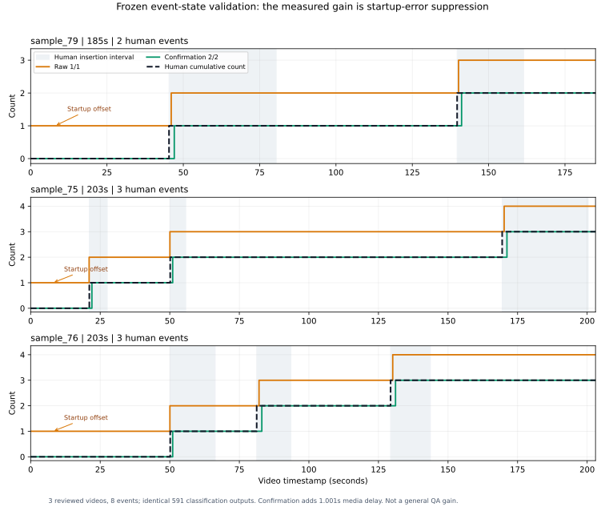

# Three-video human event validation

All three human exports match the frozen manifests and confirm complete-prefix
review. Every video uses `split_on_presenter_return`. This is single-reviewer
self-reported annotation, not independently authenticated or double-blind truth.
The 3 videos contain 8 labelled events and 591 sampled frames; the development
video sample80 is excluded from these aggregates. Predictions, prompts and rules
were frozen before inference and are unchanged after human review.

## Primary results

Event matching: one-to-one temporal IoU>=0.5. Counts: six predeclared relative
query points per video, 18 correlated queries total.

| Pooled metric | Raw1/1 | Confirmation2/2 |
|---|---:|---:|
| Predicted / matched / human events | 11 / 8 / 8 | 8 / 8 / 8 |
| Micro precision | 72.7% | 100% |
| Micro recall | 100% | 100% |
| Micro F1 | 0.8421 | 1.0000 |
| Video-macro precision | 72.2% | 100% |
| Video-macro F1 | 0.8381 | 1.0000 |
| Count MAE, 18 frozen queries | 1.0000 | 0.0000 |
| Correct counts, frozen queries | 0/18 | 18/18 |
| Mean confirmation delay, event-weighted | 0.405s | 1.406s |

Delay is signed **media time on matched events**, not end-to-end live latency.
Video-macro mean delays are0.4259s and1.4269s respectively. Two-frame confirmation
adds1.001s for each matched event under the observed1FPS sampling cadence.

| Video | Human events | Raw precision | Confirmation precision | Raw / confirmation count MAE |
|---|---:|---:|---:|---:|
| sample79 | 2 | 66.7% | 100% | 1 / 0 |
| sample75 | 3 | 75% | 100% | 1 / 0 |
| sample76 | 3 | 75% | 100% | 1 / 0 |

Both methods recall all labelled events in every case. Human endpoint counts
2/3/3 agree with the corresponding existing dataset QA numeric labels; those
QA labels were not used for selection, state tuning or human interval creation.

## Critical finding: all measured gain is startup-artifact suppression

Each raw counter admits exactly one unmatched interval[0,1.001)s. The three
videos share an identical fully black initial JPEG, which the classifier labels
inserted_scene. Confirmation rejects the isolated startup label. **All three
false events are this same failure type; no later false event was observed.**

This replicates startup error propagation and its suppression. It does not show
that the confirmation rule solves general temporal memory failures, improves
semantic retrieval or helps on diverse temporal noise. A simple black-frame
input gate could explain the same precision benefit with less confirmation
delay; that baseline has **not** been run in this frozen validation.

The shortest labelled insertion is5.585s, and the shortest within-video presenter
gap is14.894s. There are no sub-two-second insertions or presenter returns to
stress the two-frame rule. No event is prefix-censored. Boundary estimates are
not perfect just because IoU passes0.5, and single-reviewer10FPS clip labels do
not establish millisecond timing precision.

## Predeclared dense-time secondary analysis

| All sampled timestamps | Raw | Confirmation |
|---|---:|---:|
| Count MAE | 1.00508 | 0.00846 |
| Correct counts | 0/591 | 586/591 (99.15%) |

Five confirmation mismatches occur while waiting at event entries. The raw
dense-time MAE slightly exceeds1 because some first detections precede the
human-marked onset; small negative signed delays reflect boundary/annotation
differences, not future-frame access. Timing and uncertainty near boundaries
remain relevant despite100% accuracy on the six coarse points per video.
Neither18queries nor591timestamps are independent test cases.

## Provenance and published artifacts

All3labels were supplied before publishing per-case model counts/intervals.
The UI did not prefill predictions; full traces stayed local during annotation.
This is not an independent double-blind study: the user knew development findings
and could access project files. Exact source hashes differ and each pair shares
one JPEG hash; broader source/near-duplicate independence is unverified.

- [Aggregate/per-case metrics](aggregate.json).
- [Dense-time counts and mismatch timestamps](dense-query-diagnostic.json).
- [Startup-specific failure audit](startup-analysis.json).
- Per-video scores, anonymous human intervals and the now-released original
  prediction snapshots: [sample79](sample79/scores.json),
  [sample75](sample75/scores.json), [sample76](sample76/scores.json).
- [Hashes and annotation audit](audit.json).

Raw exports/reviewer identities remain under ignored results/. Previous pre-label
performance/audit snapshots retain their original pending fields; this report
supersedes the annotation status without overwriting them. No new model calls,
training, parameter changes or modifications to prior500-QA results occurred.
Scoring was verified through the existing CLI and separate main-agent pairwise
IoU/count arithmetic; no additional independent reviewer was available.

## Next experiment

Keep this cohort's rules/results fixed. Add an explicit black-frame-gate control
as a separately labelled **posthoc artifact ablation**, rather than attributing
the whole improvement to temporal reasoning. Then validate the chosen policy on
new challenge cases with brief insertions, short presenter returns, dark scenes
and non-startup classification noise. Report recall and media-time confirmation
delay together; do not turn this3-video/8-event result into general100% streaming
understanding accuracy or an efficiency improvement claim.
