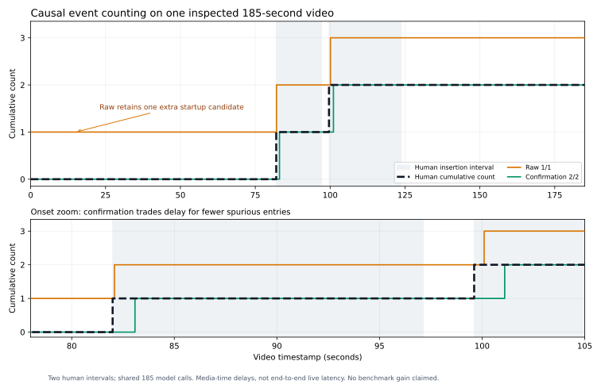

# Human event-interval scoring: submitted v1

The user supplied two complete-prefix insertion intervals:

| Event | Start | End |
|---|---:|---:|
| 1 | 81.994s | 97.133s |
| 2 | 99.613s | 123.757s |

Convention: a return to presenter followed by another insertion starts a new
event (`split_on_presenter_return`). Neither interval is cutoff-censored. Label
provenance is single-reviewer `human_self_reported`; the manifest/video binding
and full-prefix confirmation pass validation. Reviewer identity and the raw
label export remain local. Predictions and fixed rules predate these labels;
no new model calls, training or threshold tuning occurred during scoring.

## Primary frozen-protocol results

Event matching uses one-to-one temporal IoU>=0.5. Counts are evaluated at the
six predeclared media timestamps 20/60/90/110/130/185s.

| Metric | Raw1/1 | Confirmation2/2 |
|---|---:|---:|
| Predicted events | 3 | 2 |
| Matched human events | 2/2 | 2/2 |
| Event precision | 66.7% | 100% |
| Event recall | 100% | 100% |
| Event F1 | 0.80 | 1.00 |
| Count MAE, six frozen points | 1.00 | 0.00 |
| Correct counts, six frozen points | 0/6 | 6/6 |
| Mean signed confirmation delay, matched events | 0.2875s | 1.2885s |

Both policies match the two human events with identical estimated-interval IoUs
0.9346 and 0.9652. The raw-only [0,1.001) candidate has no human match. It comes
from the initial entirely black JPEG classified as inserted_scene. Two-frame
confirmation suppresses that isolated category prediction without changing any
classification output. It adds 1.001s confirmation delay at each true entry.

Per-event media confirmation delays:

| Event | Raw | Confirmation |
|---|---:|---:|
| 1 | 0.088s | 1.089s |
| 2 | 0.487s | 1.488s |

Confirmation delay is measured in video/media time. It excludes model processing
and queuing latency and is not end-to-end live answer delay. Estimated starts
are not backdated into the causal count. Ending boundaries also have sampling
error: both estimated ends are later than human ends by 0.965s and 0.367s.
The review clip is 10FPS; three decimal places in the export do not imply
millisecond-accurate human boundary annotation.

## Supplementary dense-time diagnosis (posthoc)

The six frozen queries are well away from entry boundaries. To expose the
confirmation trade-off, separately score all 185 actual frame timestamps using
the same human onset labels, without new inference or rule changes:

| Metric | Raw | Confirmation |
|---|---:|---:|
| Count MAE | 1.0000 | 0.01081 |
| Correct timestamps | 0/185 | 183/185 (98.9%) |

Confirmation is one event behind at 82.082s and 100.100s while waiting for the
second frame. These 185 correlated observations on one video are not 185 independent
QA examples. This posthoc diagnostic does not replace the original six-point
protocol. [Dense-time metadata](dense-query-diagnostic.json) retains that scope.

## Interpretation and limits

This provides an observed mechanism on this known case: raw frame classification
can create a persistent count offset from a single startup error, while causal
confirmation removes that candidate at the cost of entry delay. It does not
establish reliability across videos. Only one 185s prefix and two human events
are scored, with material already inspected during project development. The UI
did not prefill model intervals, but predictions/aggregate reports were available;
annotation is not an independently blinded or multi-reviewer benchmark.

The two counters share all 185 model calls; this state-rule ablation is controlled.
Comparisons to direct QA still differ in compute, full-history exposure, prompt
and resolution. Retain prior 500-QA results unchanged. No 100% general streaming
accuracy, perfect boundaries, or net efficiency improvement is claimed.

Next freeze these rules and examine 3-5 additional videos not used to debug the
counter, including brief insertions, lighting changes and short presenter
returns. Report event detection, onset-neighborhood counts, delay and compute
together before enlarging the claim or changing thresholds.

[Scores](scores.json), [audit](audit.json), [anonymous interval metadata](intervals.json).
Local snapshots: `event-labels-submitted-v1.json`, `human-event-scores-v1.json`.
The original pre-label summary and all 185 predictions remain unchanged.
